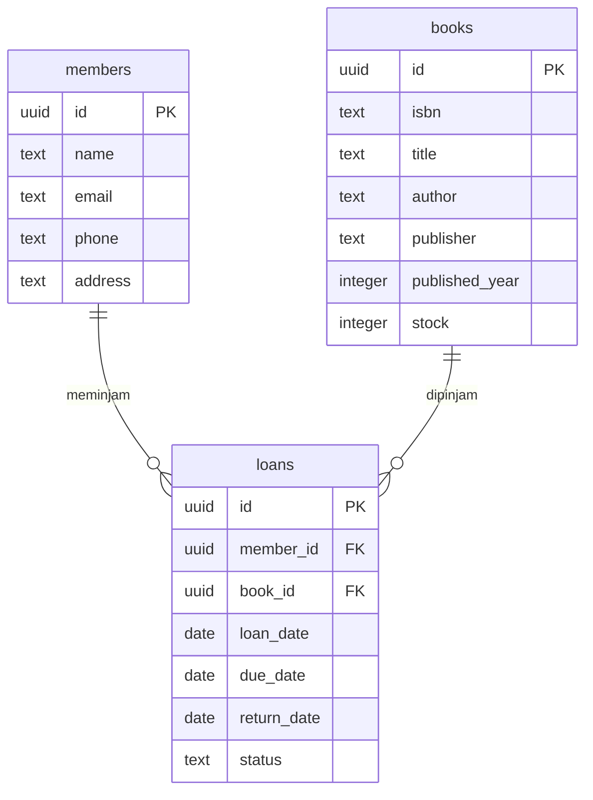

# PPB API - Peminjaman Buku Perpustakaan

RESTful API untuk layanan pencatatan peminjaman buku perpustakaan, dibangun menggunakan **Node.js**, **Express.js**, dan **Supabase** (PostgreSQL). Proyek ini merupakan bagian dari praktikum Pemrograman Perangkat Bergerak (PPB).

## Deskripsi & Tujuan Proyek

API ini menjadi *backend* bagi aplikasi perpustakaan: mencatat data anggota, koleksi buku, dan setiap transaksi peminjaman buku. Tujuan utamanya adalah menyediakan satu sumber data (*single source of truth*) yang bisa dipakai bersama oleh aplikasi mobile/web perpustakaan melalui HTTP JSON, sehingga pencatatan peminjaman tidak lagi dilakukan manual.

Fitur yang disediakan:

- CRUD lengkap (Create, Read, Update, Delete) untuk **anggota** (`members`), **buku** (`books`), dan **peminjaman** (`loans`).
- **Filter query** pada daftar peminjaman: `?status=`, `?member_id=`, dan `?book_id=` — misalnya `GET /api/loans?status=Terlambat`.
- **Penandaan otomatis status `Terlambat`**: peminjaman yang melewati `due_date` dan belum dikembalikan otomatis berstatus `Terlambat` saat data dibaca.
- **Relasi**: setiap peminjaman menyertakan data anggota dan buku yang dipinjam (hasil *join*).
- Validasi input dasar (`member_id`, `book_id`, dan `due_date` wajib diisi; nilai `status` dibatasi oleh *check constraint* di database).
- Dapat di-*deploy* sebagai *serverless function* di **Netlify**.

## Teknologi yang Digunakan

| Komponen | Teknologi |
| --- | --- |
| Runtime | Node.js 18+ |
| Web framework | Express.js 5 |
| Database | Supabase (PostgreSQL) via `@supabase/supabase-js` |
| Deployment | Netlify Functions + `serverless-http` |
| Development | nodemon, dotenv |

## Struktur Proyek

```text
PPB_Mod1_Library_API/
├── netlify/
│   └── functions/
│       └── api.mjs              # Express dibungkus serverless-http (khusus Netlify)
├── public/
│   └── index.html               # Halaman statis berisi daftar endpoint
├── src/
│   ├── config/
│   │   └── supabaseClient.js    # Inisialisasi client Supabase
│   ├── controllers/             # Menerima request, memanggil model, menyusun response
│   ├── models/                  # Query ke tabel Supabase
│   ├── routes/                  # Definisi endpoint per resource
│   ├── index.js                 # Aplikasi Express (routes + middleware)
│   └── server.js                # Entry point lokal (app.listen)
├── netlify.toml                 # Konfigurasi build & rewrite Netlify
├── schema.sql                   # Query pembuatan tabel (jalankan di Supabase)
├── seed.sql                     # Data contoh (opsional)
├── .env.example                 # Template environment variables
└── package.json
```

## Struktur Basis Data (Supabase)

Jalankan seluruh isi `schema.sql` di **Supabase Dashboard → SQL Editor → New query → Run** sebelum menjalankan aplikasi.

```sql
create table members (
  id uuid primary key default gen_random_uuid(),
  name text not null,
  email text,
  phone text,
  address text
);

create table books (
  id uuid primary key default gen_random_uuid(),
  isbn text unique,
  title text not null,
  author text,
  publisher text,
  published_year integer,
  stock integer not null default 1
);

create table loans (
  id uuid primary key default gen_random_uuid(),
  member_id uuid not null references members(id) on delete cascade,
  book_id uuid not null references books(id) on delete cascade,
  loan_date date not null default current_date,
  due_date date not null,
  return_date date,
  status text not null default 'Dipinjam'
    check (status in ('Dipinjam', 'Dikembalikan', 'Terlambat'))
);
```

### Relasi antar tabel



### Keterangan kolom

**`members`** — data anggota perpustakaan

| Kolom | Tipe | Keterangan |
| --- | --- | --- |
| `id` | uuid | Primary key, dibuat otomatis |
| `name` | text | Nama anggota (wajib) |
| `email` | text | Email anggota |
| `phone` | text | Nomor telepon |
| `address` | text | Alamat |

**`books`** — data koleksi buku

| Kolom | Tipe | Keterangan |
| --- | --- | --- |
| `id` | uuid | Primary key, dibuat otomatis |
| `isbn` | text | ISBN, unik |
| `title` | text | Judul buku (wajib) |
| `author` | text | Penulis |
| `publisher` | text | Penerbit |
| `published_year` | integer | Tahun terbit |
| `stock` | integer | Jumlah eksemplar (informasi, tidak dikurangi otomatis oleh API) |

**`loans`** — transaksi peminjaman

| Kolom | Tipe | Keterangan |
| --- | --- | --- |
| `id` | uuid | Primary key, dibuat otomatis |
| `member_id` | uuid | Referensi ke `members.id` (wajib) |
| `book_id` | uuid | Referensi ke `books.id` (wajib) |
| `loan_date` | date | Tanggal pinjam, default hari ini |
| `due_date` | date | Tenggat pengembalian (wajib) |
| `return_date` | date | Tanggal dikembalikan, `null` selama belum kembali |
| `status` | text | `Dipinjam`, `Dikembalikan`, atau `Terlambat` (default `Dipinjam`) |

> **Catatan RLS:** tabel di atas dibuat lewat SQL Editor sehingga *Row Level Security* nonaktif dan API dapat mengakses data. Jika Anda mengaktifkan RLS, tambahkan *policy* yang sesuai atau gunakan *service role key* pada environment variable `SUPABASE_KEY`.

Setelah tabel dibuat, Anda dapat menjalankan `seed.sql` untuk mengisi data contoh (3 anggota, 4 buku, 5 peminjaman).

## Daftar Endpoint

Base URL lokal: `http://localhost:3000` — semua endpoint diawali `/api`.

### Anggota

| Method | Endpoint | Keterangan |
| --- | --- | --- |
| GET | `/api/members` | Daftar anggota (urut nama) |
| GET | `/api/members/:id` | Detail satu anggota |
| POST | `/api/members` | Tambah anggota |
| PUT | `/api/members/:id` | Ubah data anggota |
| DELETE | `/api/members/:id` | Hapus anggota |

### Buku

| Method | Endpoint | Keterangan |
| --- | --- | --- |
| GET | `/api/books` | Daftar buku (urut judul) |
| GET | `/api/books/:id` | Detail satu buku |
| POST | `/api/books` | Tambah buku |
| PUT | `/api/books/:id` | Ubah data buku |
| DELETE | `/api/books/:id` | Hapus buku |

### Peminjaman

| Method | Endpoint | Keterangan |
| --- | --- | --- |
| GET | `/api/loans` | Daftar peminjaman, mendukung filter query |
| GET | `/api/loans/:id` | Detail satu peminjaman |
| POST | `/api/loans` | Catat peminjaman baru |
| PUT | `/api/loans/:id` | Ubah peminjaman (mis. menandai buku dikembalikan) |
| DELETE | `/api/loans/:id` | Hapus data peminjaman |

Filter pada `GET /api/loans` (semua opsional, bisa dikombinasikan):

| Parameter | Nilai | Contoh |
| --- | --- | --- |
| `status` | `Dipinjam` \| `Dikembalikan` \| `Terlambat` | `/api/loans?status=Terlambat` |
| `member_id` | uuid anggota | `/api/loans?member_id=<uuid>` |
| `book_id` | uuid buku | `/api/loans?book_id=<uuid>` |

## Contoh Request dan Response

> Contoh di bawah memakai data dari `seed.sql`. Nilai `id` (uuid) dibuat otomatis oleh Supabase, jadi pada database Anda angkanya akan berbeda.

### 1. Menambah anggota

```bash
curl -X POST http://localhost:3000/api/members \
  -H "Content-Type: application/json" \
  -d '{
    "name": "Budi Santoso",
    "email": "budi@example.com",
    "phone": "081234567890",
    "address": "Jl. Diponegoro No. 12, Semarang"
  }'
```

Response `201 Created`:

```json
{
  "id": "6f1c1d0e-3b7a-4f0e-9e1a-2f2c9d4b7a11",
  "name": "Budi Santoso",
  "email": "budi@example.com",
  "phone": "081234567890",
  "address": "Jl. Diponegoro No. 12, Semarang"
}
```

### 2. Menambah buku

```bash
curl -X POST http://localhost:3000/api/books \
  -H "Content-Type: application/json" \
  -d '{
    "isbn": "9789799731234",
    "title": "Laskar Pelangi",
    "author": "Andrea Hirata",
    "publisher": "Bentang Pustaka",
    "published_year": 2005,
    "stock": 5
  }'
```

Response `201 Created`:

```json
{
  "id": "b2a51c76-0a4d-4a71-9c7e-8e5c0f2a9d33",
  "isbn": "9789799731234",
  "title": "Laskar Pelangi",
  "author": "Andrea Hirata",
  "publisher": "Bentang Pustaka",
  "published_year": 2005,
  "stock": 5
}
```

### 3. Mencatat peminjaman baru

`loan_date` bersifat opsional (default tanggal hari ini), `status` otomatis `Dipinjam`.

```bash
curl -X POST http://localhost:3000/api/loans \
  -H "Content-Type: application/json" \
  -d '{
    "member_id": "6f1c1d0e-3b7a-4f0e-9e1a-2f2c9d4b7a11",
    "book_id": "b2a51c76-0a4d-4a71-9c7e-8e5c0f2a9d33",
    "due_date": "2026-10-24"
  }'
```

Response `201 Created`:

```json
{
  "id": "9c8d7e6f-5a4b-4c3d-8e2f-1a0b9c8d7e6f",
  "loan_date": "2026-10-10",
  "due_date": "2026-10-24",
  "return_date": null,
  "status": "Dipinjam",
  "member_id": "6f1c1d0e-3b7a-4f0e-9e1a-2f2c9d4b7a11",
  "book_id": "b2a51c76-0a4d-4a71-9c7e-8e5c0f2a9d33",
  "members": {
    "id": "6f1c1d0e-3b7a-4f0e-9e1a-2f2c9d4b7a11",
    "name": "Budi Santoso",
    "email": "budi@example.com"
  },
  "books": {
    "id": "b2a51c76-0a4d-4a71-9c7e-8e5c0f2a9d33",
    "title": "Laskar Pelangi",
    "author": "Andrea Hirata"
  }
}
```

Jika ada field wajib yang kosong, server membalas `400 Bad Request`:

```json
{ "error": "member_id, book_id, and due_date are required" }
```

### 4. Menampilkan semua peminjaman

```bash
curl http://localhost:3000/api/loans
```

Response `200 OK` (dipotong):

```json
[
  {
    "id": "9c8d7e6f-5a4b-4c3d-8e2f-1a0b9c8d7e6f",
    "loan_date": "2026-10-10",
    "due_date": "2026-10-24",
    "return_date": null,
    "status": "Dipinjam",
    "member_id": "6f1c1d0e-3b7a-4f0e-9e1a-2f2c9d4b7a11",
    "book_id": "b2a51c76-0a4d-4a71-9c7e-8e5c0f2a9d33",
    "members": { "id": "6f1c1d0e-3b7a-4f0e-9e1a-2f2c9d4b7a11", "name": "Budi Santoso", "email": "budi@example.com" },
    "books": { "id": "b2a51c76-0a4d-4a71-9c7e-8e5c0f2a9d33", "title": "Laskar Pelangi", "author": "Andrea Hirata" }
  }
]
```

### 5. Filter peminjaman terlambat

```bash
curl "http://localhost:3000/api/loans?status=Terlambat"
```

Response `200 OK` (hasil nyata dari data `seed.sql`):

```json
[
  {
    "id": "28575517-9a37-415a-8eb8-295ae061763f",
    "loan_date": "2026-09-19",
    "due_date": "2026-10-03",
    "return_date": null,
    "status": "Terlambat",
    "member_id": "868e304a-8971-4229-8491-5348ab8aa77b",
    "book_id": "a351bbc1-aed0-4e08-8dc7-733f5a7c9f1e",
    "members": {
      "id": "868e304a-8971-4229-8491-5348ab8aa77b",
      "name": "Budi Santoso",
      "email": "budi@example.com"
    },
    "books": {
      "id": "a351bbc1-aed0-4e08-8dc7-733f5a7c9f1e",
      "title": "Laskar Pelangi",
      "author": "Andrea Hirata"
    }
  }
]
```

Filter lain:

```bash
curl "http://localhost:3000/api/loans?status=Dipinjam"
curl "http://localhost:3000/api/loans?member_id=6f1c1d0e-3b7a-4f0e-9e1a-2f2c9d4b7a11"
curl "http://localhost:3000/api/loans?status=Dipinjam&book_id=b2a51c76-0a4d-4a71-9c7e-8e5c0f2a9d33"
```

### 6. Detail satu peminjaman

```bash
curl http://localhost:3000/api/loans/9c8d7e6f-5a4b-4c3d-8e2f-1a0b9c8d7e6f
```

Response `200 OK`: satu objek peminjaman (bentuknya sama seperti contoh di atas).

Jika `id` tidak ditemukan, server membalas `404 Not Found`:

```json
{ "error": "JSON object requested, multiple (or no) rows returned" }
```

### 7. Mengembalikan buku

Cukup kirim `status` baru; `return_date` otomatis diisi tanggal hari ini.

```bash
curl -X PUT http://localhost:3000/api/loans/9c8d7e6f-5a4b-4c3d-8e2f-1a0b9c8d7e6f \
  -H "Content-Type: application/json" \
  -d '{ "status": "Dikembalikan" }'
```

Response `200 OK` (dipotong):

```json
{
  "id": "9c8d7e6f-5a4b-4c3d-8e2f-1a0b9c8d7e6f",
  "status": "Dikembalikan",
  "return_date": "2026-10-10",
  "...": "field lainnya"
}
```

### 8. Menghapus data

```bash
curl -X DELETE http://localhost:3000/api/loans/9c8d7e6f-5a4b-4c3d-8e2f-1a0b9c8d7e6f
```

Response `200 OK`:

```json
{ "message": "Loan deleted successfully" }
```

## Panduan Instalasi & Menjalankan Lokal

### Persyaratan

- [Node.js](https://nodejs.org/) 18 atau lebih baru
- Akun & project [Supabase](https://supabase.com/)
- Git (opsional)
- [Postman](https://www.postman.com/) (opsional, untuk pengujian)

### Langkah-langkah

1. **Clone repositori**

   ```bash
   git clone <URL_REPOSITORY>
   cd PPB_Mod1_Library_API
   ```

2. **Instal dependensi**

   ```bash
   npm install
   ```

3. **Siapkan database Supabase**

   - Buat project di [supabase.com](https://supabase.com/).
   - Jalankan isi `schema.sql` di **SQL Editor**.
   - (Opsional) jalankan `seed.sql` untuk data contoh.

4. **Konfigurasi environment variables**

   Buat file `.env` di root proyek (sejajar `package.json`):

   ```env
   SUPABASE_URL=https://xxxxxxxxxxxx.supabase.co
   SUPABASE_KEY=service-role-atau-anon-public-key
   PORT=3000
   ```

   Kredensial didapat dari **Project Settings → API**. Gunakan *service role key* bila RLS aktif, atau *anon public key* bila RLS nonaktif.

5. **Jalankan server**

   ```bash
   npm run dev     # development, otomatis restart saat kode berubah
   npm start       # production
   ```

6. **Pastikan server berjalan**

   ```text
   Server running on port 3000
   ```

   Uji cepat:

   ```bash
   curl http://localhost:3000/api
   curl http://localhost:3000/api/loans?status=Terlambat
   ```

### Pengujian dengan Postman

Import collection (jika tersedia dari praktikum) atau buat request baru dengan base URL `http://localhost:3000/api` untuk setiap endpoint pada tabel di atas.

## Deploy ke Netlify

API ini di-*deploy* sebagai Netlify Function: aplikasi Express dibungkus `serverless-http` (`netlify/functions/api.mjs`), dan `netlify.toml` me-*rewrite* `/api/*` ke function tersebut sehingga URL publiknya tetap `/api/...`.

| Berkas | Peran |
| --- | --- |
| `netlify.toml` | Konfigurasi build, bundler function, dan redirect `/api/*` |
| `netlify/functions/api.mjs` | Entry point function; menormalkan path lalu meneruskan ke Express |
| `public/index.html` | Halaman statis berisi daftar endpoint (dipakai sebagai `publish` directory) |
| `src/server.js` | **Tidak** dipakai di Netlify (hanya untuk lokal); function memakai `src/index.js` |

Langkah deploy:

1. Set environment variables di Netlify (**Site configuration → Environment variables**): `SUPABASE_URL` dan `SUPABASE_KEY`. File `.env` tidak ikut ter-*deploy* karena ada di `.gitignore`.
2. Deploy melalui Git (hubungkan repositori ke Netlify) atau lewat CLI:
   ```bash
   npx netlify-cli deploy --prod
   ```
3. Setelah selesai, API dapat diakses di `https://<nama-site>.netlify.app/api/...`.

### Link Hasil Deployment

| | URL |
| --- | --- |
| Beranda & daftar endpoint | <https://mod1ppba.netlify.app> |
| Base URL API | <https://mod1ppba.netlify.app/api> |
| Contoh filter | <https://mod1ppba.netlify.app/api/loans?status=Terlambat> |
| Daftar peminjaman (JSON) | <https://mod1ppba.netlify.app/api/loans> |

Semua endpoint pada tabel sebelumnya dapat dipanggil dengan mengganti `http://localhost:3000` menjadi `https://mod1ppba.netlify.app`, contoh:

```bash
curl "https://mod1ppba.netlify.app/api/loans?status=Terlambat"
```

### Catatan platform

Karena berjalan di dalam Netlify Functions, berlaku batas platform: ada *cold start*, batas durasi eksekusi (default 10 detik), dan tidak ada proses server yang hidup terus. Aplikasi ini *stateless* — seluruh data tersimpan di Supabase — sehingga `app.listen()` sengaja ditempatkan di `src/server.js` yang hanya dipakai untuk lokal.
